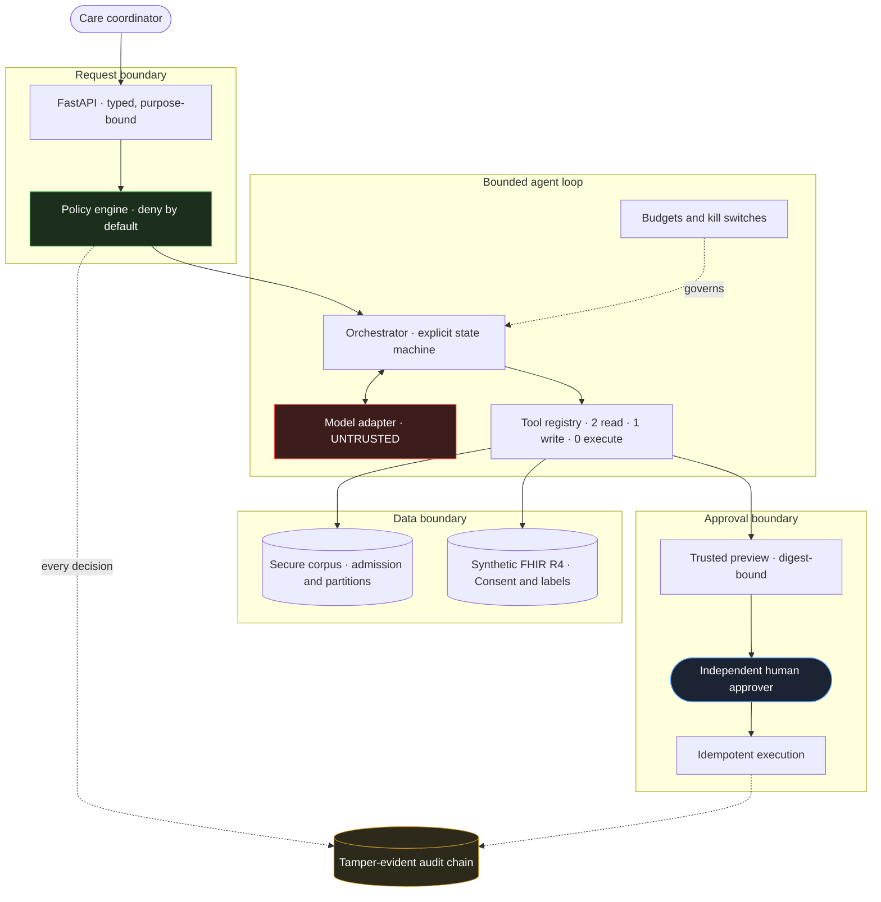

# Project Polaris

**An end-to-end simulation of safe and secure adoption of an internal, constrained agentic AI
capability at the fictional healthcare enterprise Northstar Medical.**


Most AI portfolios show that a model can answer a question. This one shows the harder half: what the
system **cannot** do, who decided that, how it is enforced in code, and how you would prove it to an
auditor a year later.

Twelve milestones take one narrow capability — answer approved policy questions and draft
administrative follow-up tasks — from business intake through governance, threat modelling, secure
implementation, assurance, red teaming, operations, audit, and retirement.

> **New here?** Start with the **[case study](portfolio/case-study.md)** (5 min), then the
> **[evidence tour](portfolio/evidence-tour.md)** (10 min).

---

## What this demonstrates

| Discipline | Worked artifact in this repository |
|---|---|
| **AI security architecture** | The model is an untrusted requester behind a bounded loop — enforced by types, not policy documents ([ADR-011](docs/architecture/decisions/ADR-011-bounded-agent-and-model-boundary.md)) |
| **Identity & access** | Strict RS256 OIDC, trusted JWKS rotation, RFC 8693 delegation, durable CAEP/SSF continuous access ([ADR-003](docs/architecture/decisions/ADR-003-oidc-and-delegation.md), [ADR-007](docs/architecture/decisions/ADR-007-durable-identity-signals.md)) |
| **Secure RAG** | Deny-by-default corpus admission, authorization computed *before* scoring, conflict abstention, audited corpus rollback ([ADR-010](docs/architecture/decisions/ADR-010-secure-retrieval-boundary.md)) |
| **Healthcare data** | FHIR R4 broker with security labels, explicit Consent, denial-before-read, minimum-necessary projection ([ADR-005](docs/architecture/decisions/ADR-005-synthetic-fhir-r4-boundary.md)) |
| **Application security** | Inert output rendering, approval previews cryptographically bound to the canonical action ([ADR-012](docs/architecture/decisions/ADR-012-trusted-presentation-boundary.md)) |
| **Privacy engineering** | DPIA, LINDDUN threat model, data-flow inventory, minimization enforced in the audit trail |
| **Clinical safety** | Hazard analysis, prohibited-scope enforcement, fixed emergency routing that cannot assess urgency |
| **Supply chain** | Offline release gate, CycloneDX SBOM, a generated **AIBOM**, hardened container ([ADR-013](docs/architecture/decisions/ADR-013-supply-chain-and-release-policy.md)) |
| **Assurance & red team** | 21 attacks across 14 classes, each naming the control expected to stop it |
| **Operations & IR** | Detection-as-code, seven incident playbooks, five executed game-day drills |
| **Governance** | 70 requirements → 25 risks → 31 controls → 71 verifications → 40 evidence records, machine-validated |
| **Lifecycle** | Change-impact analysis, audit package assembly, an executed retirement exercise |

---

## Architecture

Every arrow crossing into a new boundary is an authorization decision made in deterministic code —
never by the model.



**The model never decides whether a request is allowed.** It proposes; the policy engine, the
retrieval index, and a human approver decide. A fully compromised model can waste a run — it cannot
widen retrieval, obtain a credential, bypass approval, or execute anything.

---

## One request, end to end

<details>
<summary><b>Follow a single "draft a follow-up task" request through every control</b></summary>

<br/>

1. **Authenticate** — strict RS256, exact issuer, audience, and type, operation scopes, revocation
   checked against durable continuous-access state.
2. **Authorize** — deny-by-default across role, facility, patient assignment, purpose of use, and
   data sensitivity. Missing context denies.
3. **Retrieve** — the caller's authorized corpus partition is computed *before* any text is scored,
   so an unauthorized chunk is never a candidate. Conflicting sources abstain rather than rank.
4. **Render as data** — retrieved text enters an envelope it cannot close. It is never read as
   instruction.
5. **Model turn** — the adapter receives a question, that envelope, and the tool names available.
   There is no field for a credential, principal, token, or session.
6. **Tool call** — authorization is re-derived from the *caller*, not from what the model asked for.
   Arguments are schema-validated; extras are refused.
7. **Validate output** — structure, size, grounding, citation authenticity, secret disclosure,
   clinical scope. Refused, never truncated.
8. **Propose** — a pending proposal. There is no execute tool.
9. **Preview** — displayed fields and the signed digest both derive from one canonical action, so a
   surface cannot show one action while the approver signs another.
10. **Approve** — an independent human, cryptographically bound, with expiry.
11. **Execute** — idempotent, reauthorized at execution time.
12. **Audit** — every step in a tamper-evident chain, carrying versions and decisions, carrying no
    credentials and no retrieved passages.

</details>

---

## Run it

Requires [uv](https://docs.astral.sh/uv/) and Python 3.12 or newer.

```bash
uv sync --locked --all-groups
make verify
```

`make verify` runs the complete gate: governance traceability, retrieval evaluation, release
supply-chain policy, the adversarial campaign, operational drills, audit package and retirement,
portfolio claim verification, dataset integrity, lint, strict typing, and the test suite.

<details>
<summary><b>Run individual proofs</b></summary>

<br/>

```bash
make red-team          # 21 attacks across 14 classes
make game-day          # kill switch, rollback, degraded mode, restart, backup/restore
make retrieval-eval    # grounding, abstention, conflict, poisoning canaries
make supply-chain      # SBOM + AIBOM + release policy
make lifecycle         # audit package + retirement exercise
make governance        # requirement to control to evidence traceability
```

Start the API locally:

```bash
cp .env.example .env
make run
```

Replace every development key in `.env` with a unique local value first. The OpenAPI UI is then at
`http://127.0.0.1:8000/docs`.

Run it in the hardened container instead — non-root, read-only root filesystem, no package manager:

```bash
make container-build
docker compose -f infrastructure/local/compose.polaris.yml up
```

Optional disposable FHIR interoperability lab, loopback only:

```bash
make fhir-up
make fhir-seed
make fhir-integration
make fhir-down
```

</details>

---

## Four bugs found by running, not reading

The most instructive parts of this repository are the places where building something surfaced a
defect that reviewing it would not have.

| What broke | Why it matters |
|---|---|
| The content scanner rejected the policy that *prohibits* diagnosis, for containing the word | The clinical-boundary control was keeping the clinical-boundary policy out of the corpus. Scanning is now sentence-scoped |
| A kill-switch drill asserted the wrong half of its control and failed on first run | With writes disabled the tool is never offered, so a well-behaved model never triggers the refusal being asserted |
| A red-team case passed because its payload matched nothing | A test that cannot fail proves nothing. It now runs the full agent and asserts no write occurred |
| The container built cleanly, then failed to start | A relocated virtualenv keeps absolute shebangs. Reading the Dockerfile would not have caught it |

---

## Navigate

**Start here**

| | |
|---|---|
| [Case study](portfolio/case-study.md) | The engineering story, in five minutes |
| [Evidence tour](portfolio/evidence-tour.md) | Risk to requirement to control to code to test |
| [Demo script](portfolio/demo-script.md) | Seven-minute walkthrough with real commands |

**Depth**

| | |
|---|---|
| [Architecture decisions](docs/architecture/decisions/) | Thirteen ADRs, each with rejected alternatives |
| [System context and trust boundaries](docs/architecture/system-context.md) | Where the boundaries are, and why |
| [Risk and threat models](docs/risk/) | STRIDE, LINDDUN, DPIA, clinical hazards, abuse cases |
| [Control library](governance/control-library.json) | Thirty-one canonical controls, machine-validated |
| [Evidence records](evidence/milestones/) | What was verified, and what was not |
| [Incident playbooks](docs/operations/ai-incident-playbooks.md) | Seven AI-specific response procedures |
| [Training package](training/curriculum.md) | Twelve-module curriculum with three worked labs |

**Engineering**

| | |
|---|---|
| [`src/polaris/agent/`](src/polaris/agent/) | Bounded orchestration, tools, budgets, kill switches |
| [`src/polaris/services/corpus.py`](src/polaris/services/corpus.py) | Corpus admission and content scanning |
| [`src/polaris/security/`](src/polaris/security/) | Identity, delegation, continuous access, policy |
| [`src/polaris/assurance/`](src/polaris/assurance/) | Adversarial campaign and release evaluation |
| [`src/polaris/operations/`](src/polaris/operations/) | Telemetry rules, detections, game-day drills |

---

## Scope

Project Polaris is an **educational simulation built entirely on synthetic data**. That constraint is
deliberate and stated throughout: the identity, delegation, retrieval, model, and persistence
adapters are non-production baselines, no hosted model is connected, and no live provider has ever
been contacted. Each limitation is recorded against the control it affects rather than omitted —
which is itself part of the demonstration.

It is not a production healthcare system, legal advice, a HIPAA compliance determination, an FDA
clearance, or evidence that any real organization is compliant. No real patient data is used
anywhere.
