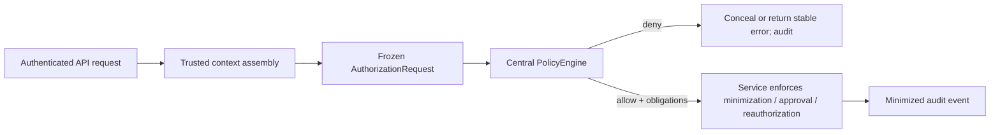

# NS-ARC-002 — Authorization Decision Table

**Status:** Executable M04 local-simulation baseline  
**Policy version:** `NS-POL-2026.08.11-3`  
**Owner:** IAM Lead  
**Reviewers:** AI Security Lead, Privacy Officer, Data Steward  
**Last updated:** 2026-08-11

## Contract

Every protected operation reaches `PolicyEngine.authorize` through a frozen
`AuthorizationRequest`. The trusted application supplies the authenticated principal, validated
purpose, explicit operation, and only the resource/action context needed for the decision. Prompts,
retrieved content, model output, and clients cannot mark an attribute trusted or override a result.

The policy response contains `allowed`, a stable non-sensitive decision code, immutable policy
version, and allow-only obligations. It contains no patient or business data. Missing required
context denies. Service code enforces obligations; the model is not involved.

## Allow matrix

| Operation | Required scope | Required role | Allowed purpose | Required context | Allow code | Enforced obligations |
|---|---|---|---|---|---|---|
| `policy.query` | `polaris.policy.read` | care coordinator, nurse, or compliance analyst | treatment, healthcare operations, security, or training | Authenticated typed principal | `POLICY_QUERY_ALLOWED` | Citations; abstain if unsupported |
| `patient.read` | `polaris.patient.read` | care coordinator or nurse | treatment or healthcare operations | Known patient, facility, nonempty known sensitivity labels, current explicit permit Consent, authorized facility, current synthetic assignment; Part 2-style role when labeled | `PATIENT_READ_ALLOWED` | Minimum summary only; no raw narrative |
| `action.propose` | `polaris.task.propose` and patient read | care coordinator or nurse | treatment or healthcare operations | Complete patient context; action patient/facility exactly matches authorized patient | `ACTION_PROPOSAL_ALLOWED` | Independent approval; exact digest |
| `action.approve` | `polaris.task.approve` | task approver | healthcare operations | Proposal requester, action facility, different approver, authorized facility | `ACTION_APPROVAL_ALLOWED` | Exact digest; approval expiry |
| `action.execute` | `polaris.task.execute` | task executor | healthcare operations | Action facility in executor facilities | `ACTION_EXECUTION_ALLOWED` | Requester reauthorization; idempotent execution |
| `audit.read` | `polaris.audit.read` | security analyst | security | Authenticated typed principal | `AUDIT_READ_ALLOWED` | No raw restricted content |

Scopes set the maximum delegated operation. They never replace workforce role, facility, patient
relationship, purpose, sensitivity, action integrity, approval, or current-state checks.

## Deny matrix and evaluation precedence

| Operation | Condition | Stable deny code | External behavior |
|---|---|---|---|
| Patient read | Missing patient, facility, sensitivity, or consent context | `PATIENT_CONTEXT_DENIED` | Concealed as patient not available at the broker boundary |
| Patient read | Missing operation scope | `PATIENT_SCOPE_DENIED` | Concealed as patient not available |
| Patient read | Wrong role | `PATIENT_ROLE_DENIED` | Concealed as patient not available |
| Patient read | Disallowed purpose | `PATIENT_PURPOSE_DENIED` | Concealed as patient not available |
| Patient read | Cross-facility | `PATIENT_FACILITY_DENIED` | Concealed as patient not available |
| Patient read | No current assignment | `PATIENT_RELATIONSHIP_DENIED` | Concealed as patient not available |
| Patient read | Consent fact unavailable or ambiguous | `PATIENT_CONSENT_UNKNOWN_DENIED` | Concealed as patient not available; no full Patient read |
| Patient read | Active Consent decision is deny | `PATIENT_CONSENT_DENIED` | Concealed as patient not available; no full Patient read |
| Patient read | Synthetic Part 2-style label without role | `PATIENT_PART2_DENIED` | Concealed as patient not available |
| Action proposal | Missing action target context | `ACTION_CONTEXT_DENIED` | Forbidden |
| Action proposal | Missing proposal scope | `ACTION_PROPOSER_SCOPE_DENIED` | Forbidden |
| Action proposal | Any patient-read denial | Patient decision code | Forbidden after broker concealment rules |
| Action proposal | Action target differs from authorized patient/facility | `ACTION_TARGET_MISMATCH` | Forbidden |
| Approval | Missing facility/requester | `APPROVER_CONTEXT_DENIED` | Forbidden |
| Approval | Wrong purpose | `APPROVAL_PURPOSE_DENIED` | Forbidden |
| Approval | Missing scope, wrong role, self-approval, or cross-facility | `APPROVER_*_DENIED` | Forbidden |
| Execution | Missing facility | `EXECUTOR_CONTEXT_DENIED` | Forbidden |
| Execution | Wrong purpose, missing scope/role, or cross-facility | `ACTION_EXECUTION_DENIED` | Forbidden |
| Audit read | Wrong purpose, scope, or role | `AUDIT_ACCESS_DENIED` | Forbidden |

Only allow decisions carry obligations. Deny decisions carry an empty obligation set. The broker
re-reads the minimum security/Consent context after the full Patient read; a consent change or any
other context drift blocks release. Audit events record the decision code and policy version without
serializing the full policy input.

## Enforcement path

## Deliberate limits

This is an in-process policy oracle for a synthetic local simulation. A separate durable local
SSF/CAEP-style receiver invalidates affected tokens/subjects but never applies event-supplied roles.
Enterprise entitlement, patient-relationship, and Consent sources; environment/authentication-
strength attributes; policy-service availability; OPA parity; durable decision logs; step-up; and
an enterprise TLS/workload-auth signal edge, stream operations, and provider interoperability
remain required before pilot or production. The decision table is not a legal determination about
minimum necessary use or Part 2 consent.
