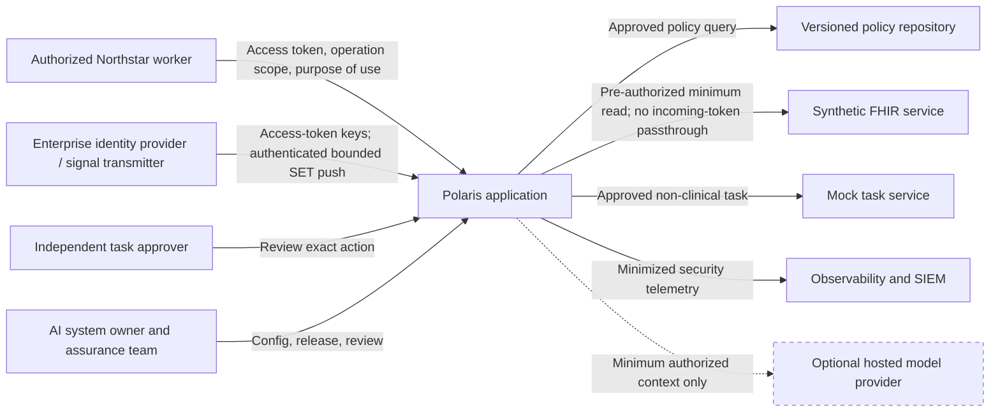
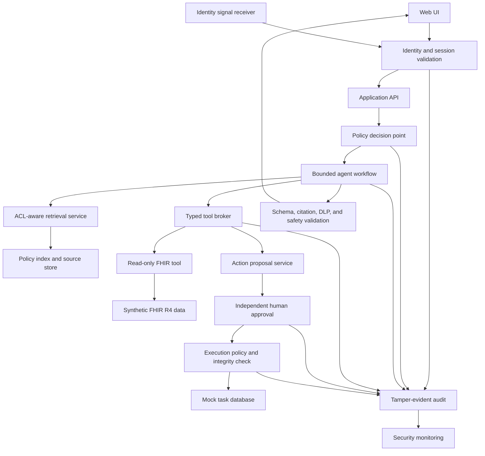

# NS-ARC-001 — System Context, Data Flow, and Trust Boundaries

**Artifact status:** Initial architecture hypothesis  
**Owner:** AI System Owner  
**Reviewers:** Enterprise Architecture, AI Security, Privacy, Clinical Safety, IAM, SRE  
**Last updated:** 2026-08-11

## System purpose

Polaris is an internal clinical-operations assistant that retrieves approved policy and minimal authorized synthetic patient context, then proposes approval-gated non-clinical follow-up tasks.

## System context

The hosted provider is deferred until a provider adapter, vendor assessment, contract criteria, and deterministic security baseline exist.

## Logical data flow

## Trust boundaries

| ID | Boundary | Untrusted or less-trusted side | Required controls |
|---|---|---|---|
| TB-001 | User device to Polaris | Browser input, pasted content, session theft | TLS design, OIDC, MFA assumption, CSRF/CSP, validation, rate limits |
| TB-002 | API to model/workflow | User/retrieved text and model output | Typed schemas, bounded state, no credentials, model treated as untrusted |
| TB-003 | Polaris to policy repository/vector index | Poisoned or unauthorized content | Approved ingestion, provenance, ACL filters, row controls, version/rollback |
| TB-004 | Polaris to FHIR service | Sensitive patient data and FHIR narrative | User-delegated scope, patient/facility/purpose/sensitivity/Consent checks, source/security labels, fixed query construction, response bounds, minimization, audit |
| TB-005 | Polaris to hosted model | Third-party processing and provider control plane | Minimum context, contract/BAA decision, retention/training restrictions, encryption, egress, rollback |
| TB-006 | Workflow to tools | Model-controlled proposal could be malicious | Allowlist, strict arguments, policy revalidation, least privilege, no token passthrough |
| TB-007 | Proposal to approval | UI deception, stale/mutated action | Canonical rendering and hash, approver identity, independence, expiry |
| TB-008 | Approval to execution | Replay, race, policy/data changes | Single use, idempotency, expiry, current policy, exact hash, transactional execution |
| TB-009 | Runtime to observability | Logs may leak data or prompts | Structured minimized events, redaction, access control, integrity, retention |
| TB-010 | Build pipeline to runtime | Compromised dependency or artifact | Reviews, locked dependencies, scanning, SBOM, signing/provenance, promotion gates |
| TB-011 | Identity transmitter to Polaris | Forged, spoofed, oversized, replayed, delayed, reordered, or unavailable security signals | Workload authentication before cryptography, stream/media/body bounds, configured issuer/key/audience/type, replay/gap/order controls, durable invalidation, freshness SLO, audit, rate limit, fail closed |

## Principal data objects

| Object | Classification | Permitted context | Retention intent |
|---|---|---|---|
| Workforce identity and authorization claims | Confidential | Policy and audit only; minimum passed to model | Session plus required audit record |
| Purpose-of-use assertion | Confidential | Policy decision and audit | Required audit period |
| Approved policy content | Internal/Confidential | Model context only after source and ACL validation | Source lifecycle and version history |
| Synthetic patient summary | Northstar Restricted Health Data | Minimum fields for approved user/task only | Request scope; avoid raw prompt logging |
| Prompt and response | Mixed | Application workflow; minimized persistence | Configurable; default to no raw restricted content in logs |
| Action proposal | Confidential/Restricted depending on contents | Approval and execution services | Workflow and audit retention |
| Approval receipt | Confidential | Integrity and execution decision | Required audit period |
| Security/audit event | Confidential | SIEM, investigation, assurance | Defined by records and security policy |

## Security invariants

1. No model output directly authorizes or executes a tool.
2. No full patient content is retrieved before deterministic authorization from minimum security and Consent facts.
3. Retrieval authorization cannot be broadened through prompt text.
4. The model never receives a reusable credential.
5. A write requires an allowlisted action, independent approval, exact argument binding, expiry, reauthorization, and idempotency.
6. Retrieved instructions are treated as content, not control.
7. Raw restricted data and hidden model reasoning are not placed in routine logs.
8. Missing identity, purpose, policy, provenance, configuration, or evidence fails closed.
9. Model, prompt, corpus, policy, tool, and provider changes require versioned evaluation.
10. A kill switch can disable model and write capabilities independently.

## Initial deployment boundary

The current executable increment runs locally with hand-authored contract fixtures and a
checksummed Synthea-derived FHIR R4 Bundle, a deterministic model adapter, an injectable static-JWKS
OIDC verifier, a central in-process policy contract, and a pre-authorized Consent-aware read broker.
A pinned disposable HAPI server passes the provider-neutral gateway contract. A shared
transactional state boundary has an in-memory oracle and local SQLite durability adapter. A strict
local final-SSF/CAEP signed-SET subset persists revocation/entitlement invalidation and gates
authentication on stream freshness. A disabled-by-default local RFC 8935-shaped push endpoint adds
runtime hashed-bearer authentication and bounded delivery. An injected outbound client adds strict
final-SSF discovery, strictly bound configuration/status/delete/subject calls, and asynchronous
verification-request contracts. One local coordinator persists only hashed single-use correlation
state before dispatch, atomically binds a verification SET to the requested stream, survives restart
and callback races, expires unconfirmed probes, and derives fail-closed stream health. It separately
rejects state-less transmitter verification by default or records it delivery-only under an opt-in
durable quota without changing correlated health. Another coordinator persists desired status
before dispatch, reconciles exact
responses or signed stream-updated SETs, preserves outcome uncertainty, runs bounded rate-limit-aware
safe status reads without replaying writes, and denies paused, disabled, drifted, or stale status. A
local controller adds durable next-due cadence, lease-based single-flight execution, crash reclaim,
stale-worker suppression, and alert-state escalation/clear around the read primitive.
An Okta reference profile now adds final-SSF credential-change enforcement and a strict,
separately authorized System Log cursor read/normalization seam for documented source events.
These components are not an enterprise TLS/mTLS edge, complete live provider lifecycle or approved
unsolicited-event enablement/flood-control profile, atomic provider-page application/cursor
recovery, deployed HA scheduler, metric/SIEM/page delivery mechanism, live named-provider
interoperability result, or conformance claim.
Interfaces remain for PostgreSQL/HA/backup, pgvector, immutable audit/SIEM, external-task
reconciliation, enterprise OIDC/delegation/signal operations and consent, OPA, OpenTelemetry, and a
hosted model.

Local shortcuts are not production controls. Any development authentication bypass must be impossible to enable silently in a production configuration and must be covered by negative tests.
